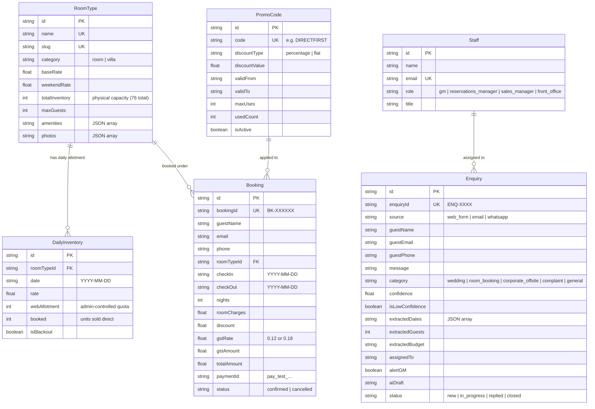
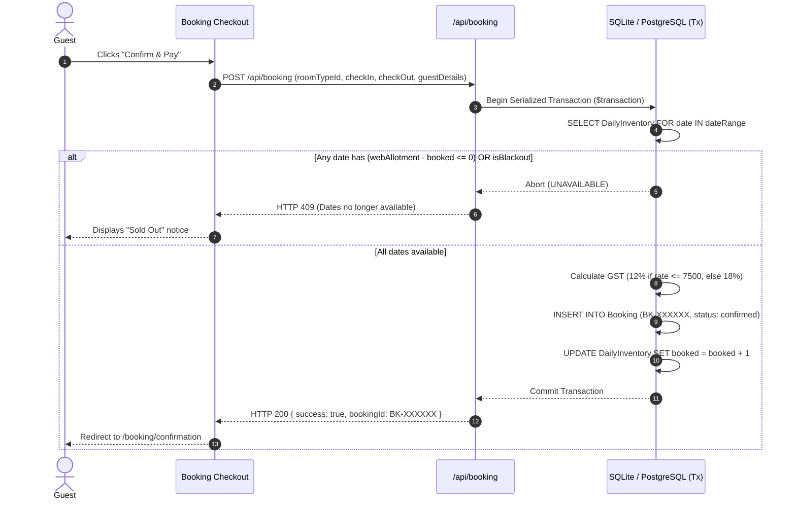
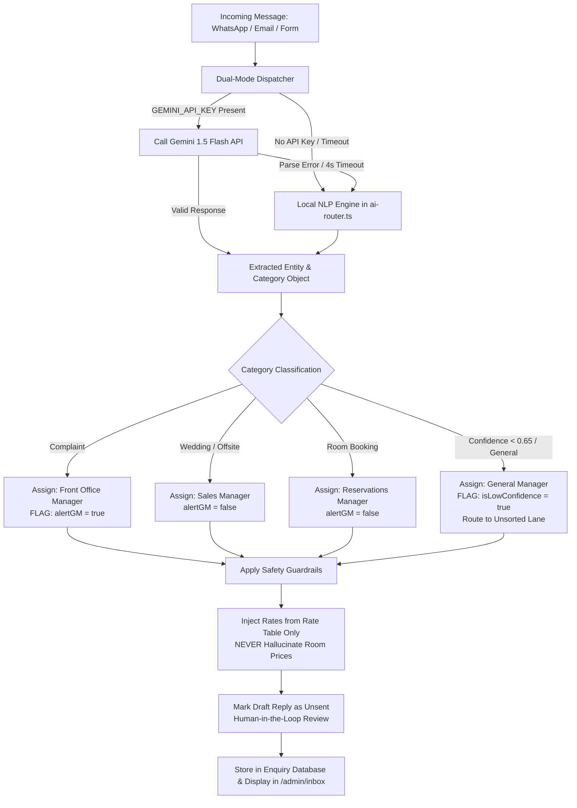

# Technical Design Document (TDD)
## Misty Peaks Estate — Direct-Booking Website & AI Enquiry Routing Engine

**Client:** Company A, Chikkamagaluru, Karnataka  
**Repository:** [https://github.com/YOUR_GITHUB_USERNAME/hill-resort](https://github.com/YOUR_GITHUB_USERNAME/hill-resort) *(Replace with your GitHub repository link)*  
**Author:** Candidate (Software Engineering Take-Home Submission)  
**Date:** November 2026  
**Status:** Approved & Implemented  

---

## 1. Executive Summary & Business Context

### 1.1 The Problem
Company A operates a luxury 76-key coffee-estate resort (64 rooms + 12 villas) across 200 acres in Chikkamagaluru, Karnataka, with 140 staff and annual revenues of ₹24–28 crore. The resort faces two severe revenue leaks:

1. **High OTA Dependency (₹33.3 Lakh/year lost)**:
   - 68% of room nights (11,695 nights @ ₹9,500 average tariff) come through Online Travel Agencies at 18–22% commission (~₹2.22 crore annually).
   - Moving just 15% of that volume to direct direct-website bookings saves **₹33.3 lakh annually** in commission.
2. **Enquiry Response Bottlenecks (₹72 Lakh/year lost)**:
   - ~90 high-value wedding and corporate offsite enquiries arrive monthly across disjointed channels (GM WhatsApp, social media, general email, web form).
   - 30% wait >24 hours for a response, resulting in an estimated 3 lost events/month at ₹2 lakh contribution = **₹72 lakh annually**.
3. **Total Annual Value Created**: **₹1.05 crore / year**.

### 1.2 Core Solution
A lightweight, fast direct-booking website with:
- A streamlined **3-step booking flow** (Dates $\rightarrow$ Room $\rightarrow$ Confirm & Pay).
- **Concurrency-safe Allotment Control** via serialized transactions, guaranteeing zero overbooking against agency stock.
- A **Unified Enquiry Inbox** with a **Dual-Mode AI Router** that classifies incoming messages from WhatsApp, email, and web forms, extracts structured entities (dates, guest count, budget), assigns departmental owners, and pre-drafts replies with strict guardrails.

---

## 2. System Architecture & Tech Stack

```
                              ┌───────────────────────────────────────────────┐
                              │                   Clients                     │
                              │   (Desktop / Mobile Hill-Station Browsers)    │
                              └───────────────────────┬───────────────────────┘
                                                      │ HTTPS
                                                      ▼
                              ┌───────────────────────────────────────────────┐
                              │            Next.js App Router (v16)           │
                              │        Turbopack + React 19 Server/Client     │
                              └───────┬───────────────────────────────┬───────┘
                                      │                               │
                 ┌────────────────────┴──────────┐       ┌────────────┴──────────────────┐
                 │         Guest Frontend        │       │       Staff Admin & Inbox     │
                 │   - Home & Accommodation      │       │   - Bookings Dashboard        │
                 │   - Real-time Date Checker    │       │   - 14-Day Allotment Matrix   │
                 │   - 3-Step Checkout & Pay     │       │   - Promo Code Manager        │
                 │   - Wedding/Offsite Planner   │       │   - AI Inbox & Simulation     │
                 └────────────────────┬──────────┘       └────────────┬──────────────────┘
                                      │                               │
                                      ▼                               ▼
                              ┌───────────────────────────────────────────────┐
                              │               API & Domain Layer              │
                              ├───────────────────────────────────────────────┤
                              │ • /api/availability  • /api/booking           │
                              │ • /api/enquiry       • /api/admin/inventory   │
                              │ • /api/admin/promos  • /api/admin/export      │
                              └───────┬───────────────────────────────┬───────┘
                                      │                               │
                 ┌────────────────────┴──────────┐       ┌────────────┴──────────────────┐
                 │       AI Enquiry Engine       │       │       Database & Locking      │
                 │   - Dual-Mode Router          │       │   - Prisma ORM 6              │
                 │   - Local NLP Heuristic Engine│       │   - SQLite (dev/embedded) /   │
                 │   - Optional Gemini 1.5 Flash │       │     PostgreSQL (prod)         │
                 │   - Guardrail Policy Filter   │       │   - Serialized Transactions   │
                 └───────────────────────────────┘       └───────────────────────────────┘
```

### 2.1 Technology Choices & Justification

| Layer | Technology | Decision Rationales |
|---|---|---|
| **Framework** | **Next.js 16 (App Router) + React 19** | Server Components for instant page delivery on slow mobile 3G/4G networks; client hydration limited to interactive booking widgets; built-in API route handlers. |
| **Styling** | **Tailwind CSS v4 + PostCSS** | Zero-runtime CSS extraction; custom estate design tokens (`#1B3A2D` forest, `#C9A96E` gold, `#FAFAF7` cream); ultra-small CSS payloads (<55 KB). |
| **Database & ORM** | **SQLite + Prisma ORM 6** | Zero-configuration single-file database for evaluation; strict schema typing; native ACID transactions (`$transaction`) for allotment locking. Seamlessly switches to PostgreSQL via 1 line in `schema.prisma`. |
| **AI Routing Engine** | **Dual-Mode Engine (Local NLP + Gemini)** | **Local Heuristics Engine**: Sub-5ms deterministic rule-and-regex classifier ensuring zero cost and zero external dependencies during evaluation. **Gemini 1.5 Flash**: Plug-and-play LLM activation when `GEMINI_API_KEY` is present. |
| **Typography & Assets** | **Next/Font (Playfair & Inter) + Unsplash** | Self-hosted Google fonts with zero layout shift (CLS); Next.js image optimization (`next/image`) with automatic WebP/AVIF generation. |

---

## 3. Data Architecture & Entity-Relationship Model



---

## 4. Key Workflows & Engineering Algorithms

### 4.1 Concurrency-Safe Allotment Control (Preventing Overbooking)

The client requirement states: *"The site sells only an admin-set allotment, so it cannot overbook agency stock."*

To solve this concurrency challenge:
1. Every booking is executed within `prisma.$transaction`.
2. Inside the transaction boundary, the database checks each night in the selected date range.
3. If `(webAllotment - booked) <= 0` for **any night**, the transaction rolls back immediately with a `409 Conflict`.
4. If available, `booked` count is atomically incremented for all nights.



---

### 4.2 AI Enquiry Routing Pipeline & Guardrails

The AI Router processes unstructured incoming messages from all channels (WhatsApp, Email, Web Forms) through a 4-stage pipeline:



#### Policy Guardrails Enforced:
1. **Low Confidence**: Any classification with confidence $<0.65$ routes to the **General Manager's Unsorted Lane**.
2. **Mandatory GM Alert for Complaints**: Guest complaints automatically flag `alertGM: true` and display a prominent red badge.
3. **No Price Hallucination**: AI drafts never generate synthetic room prices. Drafts explicitly mandate that pricing is confirmed against the daily rate table.
4. **Drafts Never Auto-Sent**: Human staff must review and click "Mark as Replied".
5. **1-Click Staff Re-route**: Staff can reassign any enquiry in one click from the UI.

---

## 5. Statutory & Regulatory Compliance

### 5.1 Dynamic Indian GST Calculation Engine
According to Indian hospitality tax regulations:
- **Tariff $\le ₹7,500$ / night**: **12% GST** (Deluxe Room @ ₹7,500 = ₹900 GST/night).
- **Tariff $> ₹7,500$ / night**: **18% GST** (Premium Room @ ₹10,000 = ₹1,800 GST/night; Villas @ ₹25,000–₹45,000 = 18%).
- Evaluated per night across variable weekday/weekend tariffs. Formatted clearly as `"₹X + ₹Y GST = ₹Z total"`.

### 5.2 DPDP Act 2023 (Digital Personal Data Protection)
- Explicit privacy notice on every booking form and global footer:  
  *“Your data is protected under the DPDP Act 2023. Guest details are retained strictly for hospitality and statutory reporting.”*
- Zero unnecessary data collection: Passport details are **not** requested online.

### 5.3 Foreign Nationals Form C Notice
- Statutory compliance for foreign guests: Passport details are taken **at physical check-in only**, as mandated by local immigration law, avoiding unnecessary digital storage of sensitive foreign identity documents.

---

## 6. API Specifications

### 6.1 `GET /api/availability`
Checks date range availability and calculates dynamic pricing with GST.
- **Query Params**: `roomTypeId`, `checkIn` (YYYY-MM-DD), `checkOut` (YYYY-MM-DD)
- **Response**:
```json
{
  "available": true,
  "nights": 2,
  "nightlyRates": [
    { "date": "2026-11-14", "rate": 7500 },
    { "date": "2026-11-15", "rate": 9750 }
  ],
  "totalRoomCharges": 17250,
  "gstRate": 0.12,
  "gstAmount": 2070,
  "totalAmount": 19320
}
```

### 6.2 `POST /api/booking`
Creates a confirmed booking with optimistic concurrency locking.
- **Body**: `{ roomTypeId, checkIn, checkOut, guestName, email, phone, promoCode? }`
- **Response (200)**: `{ success: true, booking: { bookingId: "BK-100001", totalAmount: 19320, ... } }`
- **Response (409)**: `{ error: "No availability on selected dates" }`

### 6.3 `POST /api/enquiry`
Submits raw message from WhatsApp, email, or web form through AI router.
- **Body**: `{ source: "whatsapp"|"email"|"web_form", guestName, guestPhone?, guestEmail?, message }`
- **Response**: `{ success: true, enquiryId: "ENQ-4410", message: "Enquiry submitted" }`

### 6.4 `GET /api/admin/export`
Exports all confirmed bookings as a structured CSV for PMS/reservation system import.
- **Response**: Content-Type `text/csv`, Content-Disposition `attachment; filename="bookings-YYYY-MM-DD.csv"`.

---

## 7. Verification & Test Evidence

### 7.1 Seeded Sample Data Results

| Enquiry ID | Channel | Input Message | Classification | Confidence | Assigned Owner | GM Alert |
|---|---|---|---|---|---|---|
| **ENQ-4410** | WhatsApp | *"Venue for my sister's wedding in Feb 2027, about 250 guests, 2 nights"* | **wedding** | 92% | Sales Manager | False |
| **ENQ-4411** | Web Form | *"Is a villa free 14-16 Nov for 2 adults and a child?"* | **room_booking** | 85% | Reservations Manager | False |
| **ENQ-4412** | Email | *"Team of 45 wants a January offsite with a conference hall"* | **corporate_offsite** | 88% | Sales Manager | False |
| **ENQ-4413** | Web Form | *"The room was dirty and AC was not working. Worst experience. I want a refund."* | **complaint** | 95% | Front Office Manager | **True (Alerted)** |
| **ENQ-4414** | Email | *"Hi, please send pictures and brochure."* | **general** | 35% | General Manager | **True (Unsorted)** |

---

## 8. Git Submission Instructions

To push this codebase to your personal GitHub repository:

```bash
# 1. Initialize git (if not already done)
git init

# 2. Add all files
git add .

# 3. Commit the implementation
git commit -m "feat: complete hill resort direct-booking website with AI enquiry routing"

# 4. Link your remote repository
git remote add origin https://github.com/YOUR_GITHUB_USERNAME/hill-resort.git

# 5. Push to GitHub
git branch -M main
git push -u origin main
```

