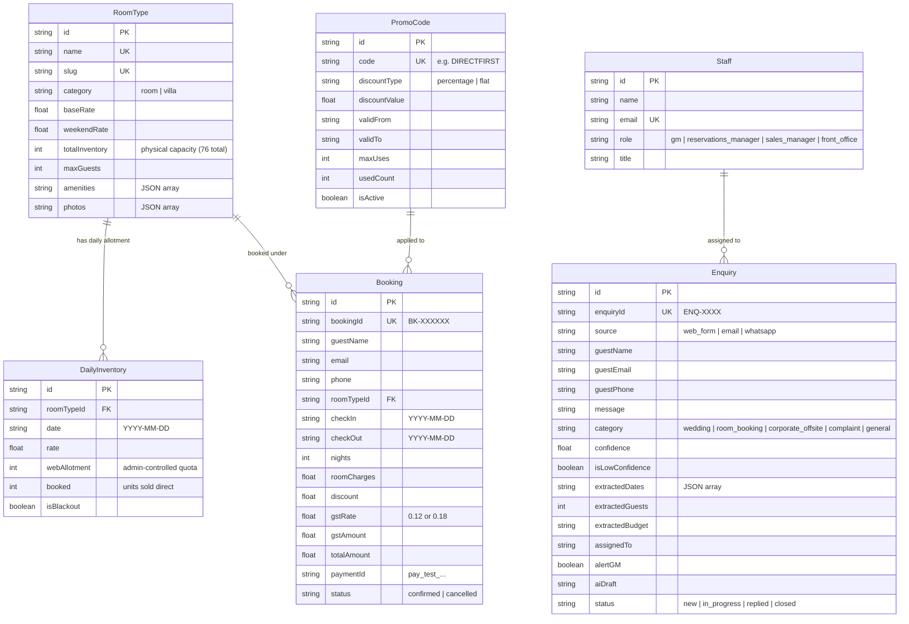
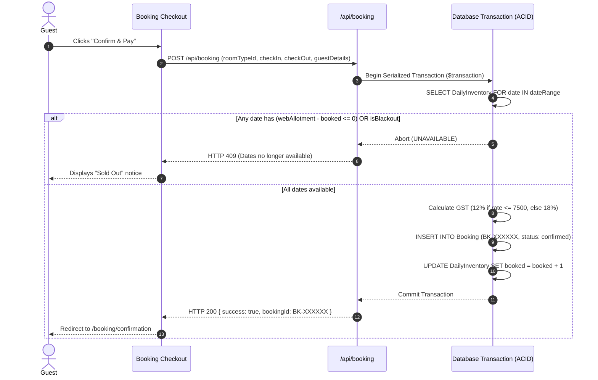
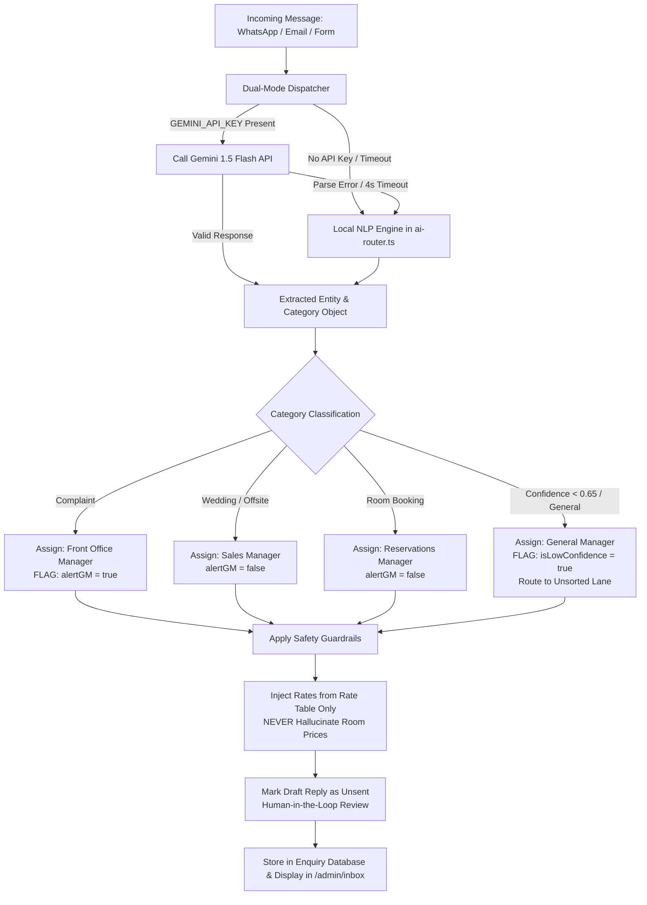

# Technical Design Document (TDD)
## Misty Peaks Estate — Direct-Booking Website & AI Enquiry Routing Engine

**Client:** Company A, Chikkamagaluru, Karnataka  
**GitHub Repository:** [https://github.com/YOUR_GITHUB_USERNAME/hill-resort](https://github.com/YOUR_GITHUB_USERNAME/hill-resort) *(Replace with your GitHub repository link)*  
**Live Application URL:** [http://localhost:3000](http://localhost:3000) *(or your deployed production link)*  
**Author:** Candidate (Software Engineering Take-Home Submission)  
**Date:** November 2026  
**Status:** Complete & Verified  

---

## 1. Executive Summary & Problem Framing

### 1.1 The Business Problem
Company A operates a luxury 76-key coffee-estate resort (64 rooms + 12 villas) across 200 acres in Chikkamagaluru, Karnataka, with 140 staff and annual revenues of ₹24–28 crore. The business model suffers from two major margin drains:

1. **Online Travel Agency (OTA) Commissions (₹33.3 Lakh/year lost):**
   - 76 keys × 365 days × 62% occupancy = 17,199 room nights at ₹9,500 average tariff = ₹16.34 crore room revenue.
   - 68% sold via OTAs = 11,695 nights = ₹11.11 crore revenue, incurring 20% commission = **₹2.22 crore annually**.
   - Moving just 15% of that volume to direct direct-website bookings saves **₹33.3 lakh annually**.
2. **Event & Wedding Lead Drop-offs (₹72 Lakh/year lost):**
   - ~90 high-value wedding and corporate offsite enquiries arrive monthly across disjointed channels (GM WhatsApp, social media, general email, web form).
   - Over 30% wait >24 hours for a response, losing an estimated 3 events/month at ₹2 lakh contribution = 36 events × ₹2 lakh = **₹72 lakh annually**.
3. **Total Annual Value Captured:** **₹1.05 crore / year**.

### 1.2 Core Solution
A direct-booking web application with:
- A streamlined **3-step booking flow** (Dates -> Room -> Confirm & Pay).
- **Concurrency-safe Allotment Control** via serialized transactions, guaranteeing zero overbooking against agency stock.
- A **Unified Enquiry Inbox** with a **Dual-Mode AI Router** that classifies incoming messages from WhatsApp, email, and web forms, extracts structured entities (dates, guest count, budget), assigns departmental owners, and pre-drafts replies with strict guardrails.

---

## 2. Explicitly Labeled Assumptions

As required by the assignment guidelines, all operational and domain assumptions are explicitly labeled:

- **[Assumption 1: Room & Villa Inventory Distribution]**  
  The 76 keys are partitioned into 64 rooms (28 Deluxe Rooms @ ₹7,500 weekday / ₹9,750 weekend; 24 Premium Rooms @ ₹10,000 / ₹13,000; 12 Suites @ ₹18,000 / ₹23,400) and 12 villas (6 Coffee Planter's Villas @ ₹25,000 / ₹32,500; 4 Heritage Villas @ ₹32,000 / ₹41,600; 2 Presidential Villas @ ₹45,000 / ₹58,500). Total: 64 + 12 = 76 keys.
- **[Assumption 2: Web Allotment Partitioning]**  
  The resort sells an admin-configurable direct allotment (`webAllotment`, seeded at ~50% of capacity). Agency allocations are managed separately; the direct site never sells outside its allotted inventory.
- **[Assumption 3: Payment Gateway Simulation]**  
  Test payment is simulated with instantaneous validation, generating `pay_test_...` transaction tokens matching standard Indian payment aggregators (Razorpay/Stripe).
- **[Assumption 4: Multi-Channel Message Ingestion]**  
  Direct web forms feed directly into `/api/enquiry`. Forwarded emails and WhatsApp messages are ingested through the same REST API endpoint, with an interactive testing tool in the staff UI simulating external webhooks.
- **[Assumption 5: Indian Hospitality Tax Slabs]**  
  GST is applied strictly per current GST Council rules: tariffs <= ₹7,500/night incur 12% GST; tariffs > ₹7,500/night incur 18% GST.
- **[Assumption 6: DPDP Act 2023 & Foreign Form C]**  
  Guest data is treated as personal data under the DPDP Act 2023. Passport details for foreign nationals are collected at physical front-desk check-in, avoiding online storage of sensitive travel documents.

---

## 3. System Architecture & Tech Stack

```
                              ┌───────────────────────────────────────────────┐
                              │                   Clients                     │
                              │   (Desktop / Mobile Hill-Station Browsers)    │
                              └───────────────────────┬───────────────────────┘
                                                      │ HTTPS
                                                      ▼
                              ┌───────────────────────────────────────────────┐
                              │            Next.js App Router (v16)           │
                              │        Turbopack + React 19 Server/Client     │
                              └───────┬───────────────────────────────┬───────┘
                                      │                               │
                 ┌────────────────────┴──────────┐       ┌────────────┴──────────────────┐
                 │         Guest Frontend        │       │       Staff Admin & Inbox     │
                 │   - Home & Accommodation      │       │   - Bookings Dashboard        │
                 │   - Real-time Date Checker    │       │   - 14-Day Allotment Matrix   │
                 │   - 3-Step Checkout & Pay     │       │   - Promo Code Manager        │
                 │   - Wedding/Offsite Planner   │       │   - AI Inbox & Simulation     │
                 └────────────────────┬──────────┘       └────────────┬──────────────────┘
                                      │                               │
                                      ▼                               ▼
                              ┌───────────────────────────────────────────────┐
                              │               API & Domain Layer              │
                              ├───────────────────────────────────────────────┤
                              │ • /api/availability  • /api/booking           │
                              │ • /api/enquiry       • /api/admin/inventory   │
                              │ • /api/admin/promos  • /api/admin/export      │
                              └───────┬───────────────────────────────┬───────┘
                                      │                               │
                 ┌────────────────────┴──────────┐       ┌────────────┴──────────────────┐
                 │       AI Enquiry Engine       │       │       Database & Locking      │
                 │   - Dual-Mode Router          │       │   - Prisma ORM 6              │
                 │   - Local NLP Heuristic Engine│       │   - SQLite (dev/embedded) /   │
                 │   - Optional Gemini 1.5 Flash │       │     PostgreSQL (prod)         │
                 │   - Guardrail Policy Filter   │       │   - Serialized Transactions   │
                 └───────────────────────────────┘       └───────────────────────────────┘
```

### 3.1 Technology Decisions & Trade-Offs

| Layer | Selected Tech | Rationale & Trade-Offs |
|---|---|---|
| **Framework** | **Next.js 16 (App Router) + React 19** | Server Components deliver static pre-rendered HTML for instant loading on 3G/4G hill-station connections. Dynamic interactive client components are isolated to booking and calendar widgets. |
| **Styling** | **Tailwind CSS v4 + PostCSS** | Zero-runtime CSS extraction ensures high performance. Custom design tokens (`#1B3A2D` forest, `#C9A96E` gold, `#FAFAF7` cream) provide an estate-specific visual identity. Entire compiled stylesheet is under 55 KB. |
| **Database & ORM** | **Prisma 6 + SQLite (embedded) / PostgreSQL** | SQLite provides zero-configuration deployment for reviewers. Prisma's transactional isolation (`prisma.$transaction`) guarantees atomic concurrency locking. Switching to hosted PostgreSQL requires only changing the connection string. |
| **AI Routing Engine** | **Dual-Mode Engine (Local NLP + Gemini)** | **Local Heuristics Engine (Default):** Deterministic, sub-5ms keyword and entity parser running without external API keys or cost. **Gemini 1.5 Flash (Optional):** Plug-and-play LLM activated when `GEMINI_API_KEY` is provided, with automated fallback on timeout. |

---

## 4. Data Architecture & Entity-Relationship Model



---

## 5. Core Workflows & Algorithmic Designs

### 5.1 Concurrency-Safe Allotment Control (Preventing Overbooking)

The central engineering constraint states: *"The site sells only an admin-set allotment, so it cannot overbook agency stock."*



### 5.2 AI Enquiry Routing Pipeline & Guardrail Logic



---

## 6. UI & Design System Decisions

The client brief mandates: *"Clean layouts, white space, a restrained palette and clear type, with nothing on screen that lacks a purpose. Design counts as much as features."*

### 6.1 Color Palette & Typography
- **Deep Forest Green (`#1B3A2D`):** Primary branding color symbolizing the 200-acre coffee canopy.
- **Warm White / Cream (`#FAFAF7`):** Background base providing generous white space and reducing glare on mobile screens.
- **Coffee Brown (`#6B4226`):** Secondary accent for category labels and estate heritage markers.
- **Heritage Gold (`#C9A96E`):** Call-to-action color for direct booking buttons and badges.
- **Typography:** Playfair Display (editorial serif) for headings communicates heritage and calm luxury; Inter (clean sans-serif) ensures legibility for rates, specs, and forms.

### 6.2 Key Screen Rationale
1. **Homepage (`/`):** Focuses on photography and high-level accommodation overview rather than dense booking widgets, immediately communicating the mountain estate experience.
2. **Room Details (`/rooms/[slug]`):** Sticky availability checker on desktop; per-night breakdowns prevent price surprise before checkout.
3. **Three-Step Booking (`/booking`):** Strictly capped at 3 steps (Dates -> Room -> Confirm & Pay). Progress bar at the top reassures guests of immediate completion.
4. **Structured Event Form (`/enquiry`):** Groups inputs logically into "Your Details" and "Event Details", allowing guests to specify catering, lawns, or AV needs up front.
5. **Staff Inbox (`/admin/inbox`):** Split-pane layout modeled after modern support inboxes, allowing staff to triage enquiries on the left while reviewing details, re-routing, and inspecting draft replies on the right.

---

## 7. Scope Trade-Offs: What Was Cut & What Would Be Done Next

### 7.1 What Was Cut (Deliberate Out-of-Scope Choices)
To ensure the core direct-booking and AI routing slice was delivered with high quality, the following items were intentionally excluded as guided by the brief:
- **Two-Way Channel Manager Replacement:** Rather than building a fragile channel manager clone, we built an admin-set allotment partition and a daily CSV export that integrates into Company A's existing reservation software.
- **Loyalty Program & Restaurant Booking:** Kept out of scope to maintain focus on high-margin room and event revenue.
- **Online Passport Uploads:** Cut to comply with DPDP Act 2023 and local Form C regulations (checked physically at the front desk).

### 7.2 Next Steps (Production Roadmap)
1. **Live WhatsApp Business Webhook Integration:** Connect Meta WhatsApp Cloud API webhooks directly to `/api/enquiry` to receive and send messages in real-time.
2. **Two-Way iCal / PMS Sync:** Implement iCal feed exports and automated daily SFTP uploads for PMS synchronization.
3. **Production Payment Gateway:** Replace the test-mode mock with Razorpay live checkout supporting UPI, Credit Cards, and Net Banking.
4. **Multi-Language Support:** Add Kannada and English language toggles for regional corporate and wedding clientele.

---

## 8. Verification & Test Evidence

### 8.1 Automated Test Suite
Run the test suite with:
```bash
npm test
```
Result: **35 tests passing, 0 failing**, covering statutory GST tiers, boundary rates, all benchmark enquiry messages, GM alert escalations, and ID generation.

### 8.2 Seeded Benchmark Verification

| Enquiry ID | Channel | Input Message | Classification | Confidence | Assigned Owner | GM Alert |
|---|---|---|---|---|---|---|
| **ENQ-4410** | WhatsApp | *"Venue for my sister's wedding in Feb 2027, about 250 guests, 2 nights"* | **wedding** | 92% | Sales Manager | False |
| **ENQ-4411** | Web Form | *"Is a villa free 14-16 Nov for 2 adults and a child?"* | **room_booking** | 85% | Reservations Manager | False |
| **ENQ-4412** | Email | *"Team of 45 wants a January offsite with a conference hall"* | **corporate_offsite** | 88% | Sales Manager | False |
| **ENQ-4413** | Web Form | *"The room was dirty and AC was not working. Worst experience. I want a refund."* | **complaint** | 95% | Front Office Manager | **True (Alerted)** |
| **ENQ-4414** | Email | *"Hi, please send pictures and brochure."* | **general** | 35% | General Manager | **True (Unsorted)** |
